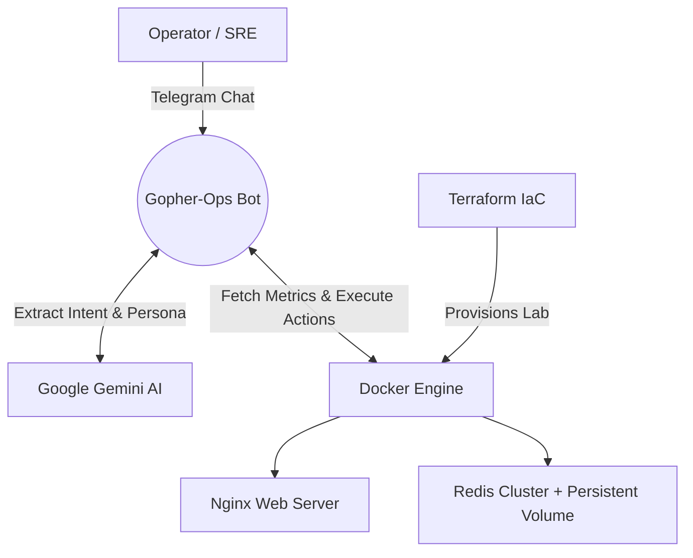

# 🤖 Gopher-Ops: AI-Driven SRE ChatOps Platform


**Gopher-Ops** is a Secure AI SRE Telegram bot managing Docker, Kubernetes, and system metrics via natural language.

## 🚀 Key Features

- **AI ChatOps:** Powered by **Google Gemini (2.0/2.5-flash)** to parse intents and logs, answering infrastructure queries in a casual persona to reduce operator cognitive load.
- **Telemetry & Observability:** Real-time monitoring of host OS (CPU/RAM), Docker, and Kubernetes states via **gopsutil**, **Docker SDK**, and **MCP**. Includes a 1-hour in-memory metric history for sustained high-load detection and proactive alerting.
- **Guided Triage & HITL Execution:** Parses AI suggestions into clickable Telegram buttons for safe actions (Start/Stop/Restart) and interactive troubleshooting flows (Network triage & Configuration validation).
- **Infrastructure as Code (IaC):** **Terraform** provisions a local microservices lab environment (Nginx, scalable/stateful Redis cluster, custom networks, and persistent volumes).
- **Sec & Ops:** Zero-Trust ID gating via Telegram; Automated Docker image vulnerability scanning; and a robust **GitHub Actions** CI/CD pipeline for Go tests and Terraform validation.
- **Kubernetes & MCP Support:** Seamlessly manages cluster operations using the **Model Context Protocol (MCP)**, bridging AI with Kubernetes native tools.
- **Robust CI/CD Pipeline:** Configured with **GitHub Actions** for automated Go unit testing and Terraform validation/formatting upon every push/PR.
- **Zero-Trust & DevSecOps:** Hardcoded Telegram Chat ID gating ensuring only the authorized operator can execute commands. Includes **automated image vulnerability scanning** for outdated Docker tags/CVEs.

## 🎮 Interactive Demo

> **Self-Healing in Action:** Watch Gopher-Ops detect a crashed Redis node, analyze the root cause (RCA) via Gemini AI, and perform an automated restart.


https://github.com/user-attachments/assets/7f9d6055-ba37-4705-b883-1d394919bcf1


## 🏗️ Architecture Workflow



## 🛠️ Tech Stack

- **Backend:** Go (Golang), Docker API SDK, gopsutil, **MCP Go SDK**
- **AI / NLP:** Google Generative AI (Gemini 2.0 Flash)
- **Infrastructure:** Docker, Kubernetes, Terraform (HCL), **MCP Server Kubernetes**
- **CI/CD:** GitHub Actions
- **Interface:** Telegram Bot API

## 📋 Prerequisites

- [Go 1.22+](https://go.dev/)
- [Docker](https://www.docker.com/) running on the host machine.
- [Terraform](https://developer.hashicorp.com/terraform/downloads) CLI installed.
- A Telegram Bot Token (from [@BotFather](https://t.me/BotFather)).
- A Google Gemini API Key.

## ⚙️ Setup & Deployment

### 1. Configure the AI Bot (Go)

Clone the repository and set up your credentials:
```bash
git clone https://github.com/yourusername/gopher-ops.git
cd gopher-ops
cp .env.example .env
go mod tidy
```
**Important:** Update `.env` with your Gemini API key, Telegram Token, and your specific `AUTHORIZED_CHAT_ID`.

### 2. Provision the Target Lab (Terraform)

Deploy the dummy microservices (Nginx & Redis) for the bot to monitor:
```bash
cd terraform
terraform init
terraform apply -auto-approve
```
*This will spin up `gopher-ops-nginx-lab` and scaled Redis nodes with persistent data volumes on a custom docker network.*

### 3. Run Gopher-Ops

Return to the root directory and boot up the SRE agent:
```bash
cd ..
go run cmd/main.go
```

## ⚙️ Configuration

All runtime behaviour is driven through environment variables (loaded from `.env`):

| Variable | Default | Purpose |
|---|---|---|
| `GEMINI_API_KEY` | _(required)_ | Google Gemini API key. |
| `TELEGRAM_BOT_TOKEN` | _(required)_ | Telegram bot token from @BotFather. |
| `AUTHORIZED_CHAT_IDS` | _(required)_ | Comma-separated Telegram chat IDs allowed to control the bot. Every operator receives every alert. |
| `AUTHORIZED_CHAT_ID` | _(legacy)_ | Single-ID fallback honored when `AUTHORIZED_CHAT_IDS` is unset. |
| `LLM_PROVIDER` | `gemini` | `gemini` or `local` (OpenAI-compatible endpoint). |
| `LLM_BASE_URL` | _(empty)_ | Base URL for the local LLM endpoint (e.g. LM Studio, Ollama). |
| `LLM_MODEL` | _(empty)_ | Model name when using a local LLM. |
| `LOCAL_LLM_API_KEY` | `lm-studio` | API key for the local LLM endpoint. |
| `AUTOPILOT_ENABLED` | `false` | When `true`, auto-restart failed containers (max 3 attempts before HITL handoff). |
| `ALERT_CPU_THRESHOLD` | `80.0` | Sustained CPU percentage that triggers an alert. |
| `ALERT_CPU_DURATION` | `5` | Minutes of sustained high CPU before alerting. |
| `ALERT_COOLDOWN_MINUTES` | `15` | Minimum minutes between repeat alerts for the same container. |
| `METRICS_HISTORY_SIZE` | `60` | Rolling window of metric points retained in memory. |
| `RCA_LOG_LINES` | `200` | Log lines passed to the AI for root-cause analysis. |
| `AI_TIMEOUT_SECONDS` | `60` | Hard timeout on every Gemini / local-LLM round trip. |
| `AI_RETRY_ATTEMPTS` | `3` | Total attempts per AI call before giving up. |
| `AI_RETRY_BASE_DELAY_MS` | `1000` | Initial backoff between AI retries; doubles per attempt. |
| `AI_DESTRUCTIVE_ALLOWED` | `false` | Set `true` to let the AI call `Stop`/`Restart` directly. Default forces HITL. |
| `RATE_LIMIT_PER_MINUTE` | `30` | Max commands per minute per operator (token bucket). |
| `TELEGRAM_QUEUE_SIZE` | `256` | Bounded backlog for the async broadcaster. |
| `HEALTH_PORT` | _(empty)_ | Port for the `/health` JSON endpoint. Empty = disabled. |
| `AUDIT_LOG_PATH` | `audit.log` | Path for the structured JSON-line audit log. |
| `AUDIT_LOG_MAX_SIZE_MB` | `10` | Rotate audit log when it exceeds this many MB. |
| `AUDIT_LOG_MAX_FILES` | `5` | Number of rotated audit files retained. |
| `MONITOR_URLS` | _(empty)_ | Comma-separated URLs probed each minute for HTTP health. |

## 🧠 Deep Root-Cause Analysis

When a container goes down — whether through an operator's "🔍 Siasat Punca" button or the autopilot loop — Gopher-Ops assembles a **three-block evidence bundle** before consulting the AI:

1. **Post-mortem inspect block** — exit code (with Unix-signal interpretation), `OOMKilled` flag, restart count, started/finished timestamps, memory & CPU limits, and the last five health-check probes.
2. **System metrics snapshot** — host CPU/RAM history for the 15 minutes leading up to the failure, so the model can correlate the crash with load spikes.
3. **Deep log tail** — 200 lines by default (tune with `RCA_LOG_LINES`), enough to capture stack traces and cascading failures that the old 10-line window missed.

The diagnosis prompt explicitly instructs the model to classify the failure (OOM / panic / healthcheck / dependency / config), separate **root cause from symptom**, and cite evidence from the bundle. This is what upgrades RCA from "guess from a few log lines" to genuine forensic reasoning.

## 🛡️ Reliability, Safety & Observability

Gopher-Ops is engineered to run unattended in production. Highlights:

- **Shared Docker client** — one socket connection reused across all packages, eliminating per-call connection churn.
- **Bounded Docker & AI calls** — every Docker request and LLM round-trip runs under a `context.WithTimeout`; a stalled daemon or hung API cannot freeze the bot.
- **Atomic state writes** — `state.json` is written via tmp + rename so a crash mid-write cannot corrupt the restart-tracker.
- **Structured audit log** — every action (autopilot decisions, AI tool calls, manual buttons, alerts, boot/shutdown) is appended as JSON-line records to `audit.log`. Reconstruct any incident long after the Telegram thread has scrolled.
- **HITL-by-default safety mode** — the AI cannot directly execute `Stop`/`Restart` unless `AI_DESTRUCTIVE_ALLOWED=true`; otherwise it must route those through the operator's confirmation buttons.
- **Markdown sanitization** — untrusted strings (container names, log payloads) are escaped before being rendered, so a hostile log line cannot break formatting or smuggle styling.
- **Alert cooldown** — flapping containers won't spam the chat; repeat alerts for the same target are suppressed for `ALERT_COOLDOWN_MINUTES`.
- **Bounded RCA cache** — entries older than 1 hour, or referring to containers that no longer exist, are evicted each tick.
- **Structured logging** — Go's `log/slog` emits key-value fields (container ID, action, error) suitable for log aggregators.
- **Graceful shutdown** — `SIGINT` / `SIGTERM` cancel the update loop and stop the background monitor cleanly.
- **Self-healing monitor** — the background goroutine is wrapped in panic recovery; if it crashes, it auto-restarts after 5 seconds without taking down the bot.

## 🚢 Production Deployment

Designed to be deployed and forgotten. Key production-grade properties:

- **Multi-operator broadcast** — set `AUTHORIZED_CHAT_IDS=111,222,333` to fan every alert to your full on-call rotation. No single point of failure if one operator's phone is dead.
- **Async Telegram queue** — alerts are enqueued and drained by a dedicated worker. The monitor loop never blocks on Telegram API latency, so a slow API cannot stall container-state polling.
- **Per-operator rate limiting** — token-bucket caps commands at `RATE_LIMIT_PER_MINUTE` per chat (default 30). A compromised account cannot weaponize the AI to burn through your Gemini quota.
- **AI retry with exponential backoff** — every Gemini / local-LLM call retries `AI_RETRY_ATTEMPTS` times (default 3) with `1s → 2s → 4s` backoff. Transient 503s or network blips no longer mean a missed diagnosis.
- **HTTP `/health` endpoint** — set `HEALTH_PORT=8080` to expose `{"status":"ok","uptime_seconds":N}` for Kubernetes liveness probes, uptime monitors, or load balancers.
- **Audit log rotation** — `audit.log` rotates at `AUDIT_LOG_MAX_SIZE_MB` (default 10 MB), keeping `AUDIT_LOG_MAX_FILES` historical copies (default 5). Disk cannot fill from forensic logging.

## 🎮 ChatOps Usage

Once the bot is running, simply PM it on Telegram to start managing your infrastructure:
- *"Bro, check system health jap"* -> Bot reads live CPU/RAM and lists the Terraform-provisioned containers.
- *"List pods dalam cluster k8s aku"* -> Bot uses MCP to fetch real-time pod data from Kubernetes.
- *"Kenapa pod database asyik restart?"* -> Bot triggers an automated `k8s-diagnose` workflow to find the root cause.

## 📁 Project Structure

```text
.
├── cmd/
│   └── main.go           # Bot entry point, Telegram handler, graceful shutdown
├── pkg/
│   ├── actions/          # Docker & Terraform execution logic
│   ├── ai/               # Gemini & local-LLM agents, tool dispatch, retry/backoff
│   ├── audit/            # Structured JSON-line audit log (with rotation)
│   ├── docker/           # Shared Docker client singleton (timeout-bounded calls)
│   ├── health/           # HTTP /health endpoint for external probes
│   ├── mcp/              # Model Context Protocol (Kubernetes) manager
│   ├── monitor/          # Metrics, container tracking, crash-context inspect
│   ├── notify/           # Async multi-operator Telegram broadcaster
│   └── ratelimit/        # Per-chat token-bucket throttling
├── terraform/            # IaC for the microservices lab
├── .github/workflows/    # CI/CD (Go tests & TF validation)
├── .env.example          # Template for required environment variables
├── demo-k8s.yaml         # Sample K8s manifest
└── README.md             # You are here!
```

## 🗺️ Roadmap

- [ ] **Multi-Cloud Support:** Integration with AWS/GCP metrics.
- [ ] **Custom Personas:** Switch between "Chill Dev" and "Strict SRE" tones.
- [ ] **Visual RCA:** Generate graphs for log patterns using AI.
- [ ] **Voice Commands:** Support for Telegram Voice Notes.

## 🤝 Contributing

Contributions are welcome! Whether it's fixing a bug, adding a new tool, or improving the documentation:
1. Fork the Project.
2. Create your Feature Branch (`git checkout -b feature/AmazingFeature`).
3. Commit your Changes (`git commit -m 'Add some AmazingFeature'`).
4. Push to the Branch (`git push origin feature/AmazingFeature`).
5. Open a Pull Request.


## 📜 Credits & Acknowledgments

The Kubernetes management capabilities of Gopher-Ops are powered by the **Model Context Protocol (MCP)** and the excellent [MCP Server Kubernetes](https://github.com/Flux159/mcp-server-kubernetes) community project. Special thanks to the authors for their work in bridging AI and Kubernetes.

## ⚠️ Disclaimer
This project binds to the host's Docker socket and Kubernetes API to execute real infrastructure lifecycles. Please ensure your `AUTHORIZED_CHAT_ID` is strictly configured to prevent unauthorized manipulation.

## 📄 License
This project is licensed under the **MIT License**. See the [LICENSE](LICENSE) file for more details.

